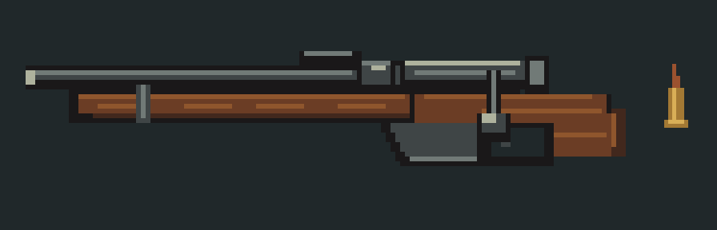

# Mosin Obrez for Half Grip

A cut-down Mosin-Nagant with **individual cartridges, a five-round internal magazine, and a bolt the player opens and closes by hand**. Version **0.2.1** corrects garage icon sizing, bolt grabbing/animation, camera-aligned loading, and the starting ammunition supply. The revision still needs in-game playtesting.



The Obrez is a separate **RaceSpec gun item** with the stable ID `obrez.mosin`. Equip it in the normal gun slot; other guns retain their own controls.

- Five loose rounds on the rack at race start; no removable magazines or clips.
- Drag cartridges into the receiver one at a time while the bolt is fully open.
- Load up to five rounds, then push the bolt fully forward to chamber one.
- After each shot, pull the bolt to eject brass, then push it closed to feed the next round.
- Releasing the bolt holds it at its current position, including partial travel. It has no return spring.
- Defaults remain 65 damage, 1.5 degrees of inaccuracy, and 1.4 times revolver recoil.

## Install

Requires **BepInEx**, **HalfGripTools 1.0.6+**, and Half Grip **0.419**. Install the dependencies through the [HalfGripMods Installer](https://github.com/4l3x4nd3r0/HalfGripMods).

Copy the whole `Obrez` folder into `<Half Grip>/BepInEx/HalfGripMods/`. When updating from 0.1.0, replace that folder so the obsolete loading-pack sprites are removed. HalfGripTools compiles the source on launch.

Obtain and equip **Mosin Obrez** through the game's gun item/shop system. It is not automatically given to every loadout.

## Controls

1. Grab the bolt with the left mouse button and pull it fully toward the cut stock. Release it: it stays open.
2. Grab an individual cartridge on the ammo rack and bring it to the open receiver, above the internal magazine. It aligns and seats in the gun. Loading proximity and the seating position use the same interior camera as the player's hand, so the different cockpit depths do not offset the target.
3. Repeat to load up to five rounds. You may also close the bolt after loading fewer rounds.
4. Grab the bolt again and push it fully toward the muzzle. This chambers one round. Loading does not close the bolt.
5. Hold the gun body to aim; right-click to fire. The gun lowers after a quarter second so the bolt is accessible.
6. Pull the bolt fully back to eject the spent case, then manually push it closed to feed another round.

Partial bolt travel neither exposes the loading gate nor chambers a round. Closing the bolt during a cartridge's insertion cancels that insertion without consuming the cartridge. Opening a live chamber ejects the live round instead of preserving it; recovering live ejected rounds is not implemented.

## Scaling and artwork

The garage icon is fitted inside 75% of the stock SMG icon's width and height using explicit pixel density. The game uses `Image.SetNativeSize`; PNG dimensions no longer inflate the inventory footprint. This is separate from cockpit sizing.

Docked length is measured from the stock gun's actual world-space width. Body, bolt, and cartridge sprites get separate pixel densities that account for their own cockpit transforms. A cartridge's height is 12% of the docked gun's length; it does not inherit the size of the old SMG magazine. Cartridge hit areas are also resized. The bolt's travel is 14% of gun length along the barrel axis. Its cylinder, handle and cocking piece form one moving sprite; the grab collider is centred on that sprite. Hand motion stays unfrozen, with zero springs and zero release momentum.

The new art has a slim barrel, remaining barrel band and leaf rear sight, faceted receiver ring, exposed bolt body, round cocking piece, straight bolt handle, angled fixed magazine, trigger guard, and a continuous cut rifle wrist. It replaces the first pass's separate pistol grip and rectangular receiver. The held mesh uses the same generated silhouette with its muzzle at the game's fire point.

## Configuration

`BepInEx/config/halfgrip.obrez.cfg` contains:

| Setting | Default | Meaning |
|---|---:|---|
| `Damage` | 65 | Damage per round |
| `Inaccuracy` | 1.5 | Spread in degrees |
| `RecoilMultiplier` | 1.4 | Recoil relative to the revolver |
| `LooseRounds` | 5 | Total starting supply; accepts four or five |
| `DockScale` | 1.0 | Docked length relative to the stock SMG; also scales bolt and cartridges |

Restart after changing these settings. The old `LoadingPacks` setting is no longer used. Existing configurations with `LooseRounds = 15` are clamped to five automatically. Extra-magazine upgrades, ammo pickups, kills and refill effects do not add cartridges to the Obrez rack; the starting supply is the full four/five-shot allowance. Dropped, unspent rounds can still be recovered.

## Development

The layout follows [jMods](https://github.com/htubdawg/jMods): a HalfGripTools source mod, stable item ID, BepInEx settings, scoped Harmony patches, and cleanup on unload/refit. The [Sniper Rifle example](https://github.com/4l3x4nd3r0/HalfGripMods/tree/main/mods/SniperRifle) informed the item and sprite-to-mesh conventions; none of its art or source is included.

All original art is generated with Python 3's standard library. PNGs are included, so players do not need Python:

```sh
python3 tools/make_assets.py
python3 tools/package.py
```

The package is `dist/HalfGripObrez-0.2.1.zip`. It contains the installable source mod and documentation, with no game assemblies.

Compile with .NET 8 and local private references:

```sh
dotnet build tools/Check.csproj -c Release -p:GameDir=/path/to/HalfGrip -p:ToolsDll=/path/to/HalfGripTools.dll
```

Run the actual ammunition-state tests without game references:

```sh
dotnet run --project tools/MechanicsTests -c Release
```

Optionally pass the path to `Assembly-CSharp.dll` after `--` to validate the private native hooks/fields by reading assembly metadata. No Unity runtime or game code is loaded by these tests.

See [validation and playtest checklist](docs/VALIDATION.md). Multiplayer and in-game alignment remain unverified.

To exercise the actual game-managed `LinearObject` with the mod's production bolt settings:

```sh
dotnet run --project tools/NativeBoltTests -c Release -p:GameDir=/path/to/HalfGrip
```

This test supplies hand input to the game's managed stepping methods without constructing a Unity engine object. It checks opening, holding position after release, and manual closing. It does not test the rendered scene, collider selection, or running Grabber. Game assemblies remain local and are not included in this repository.
